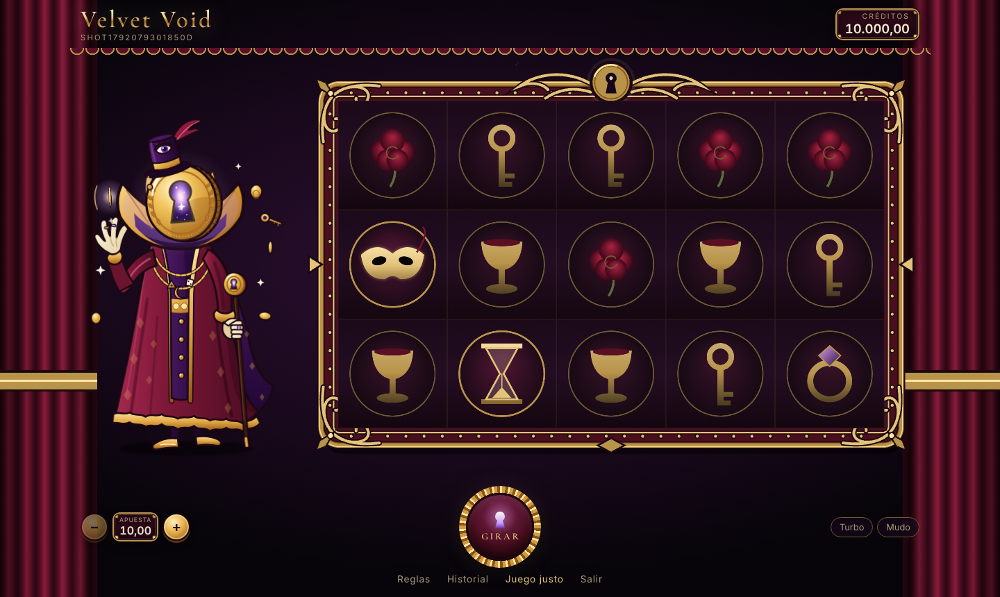
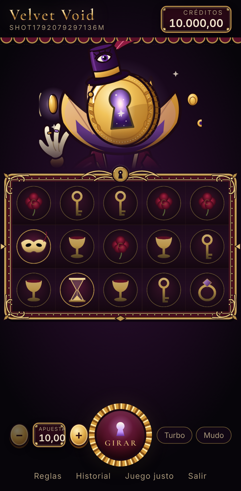
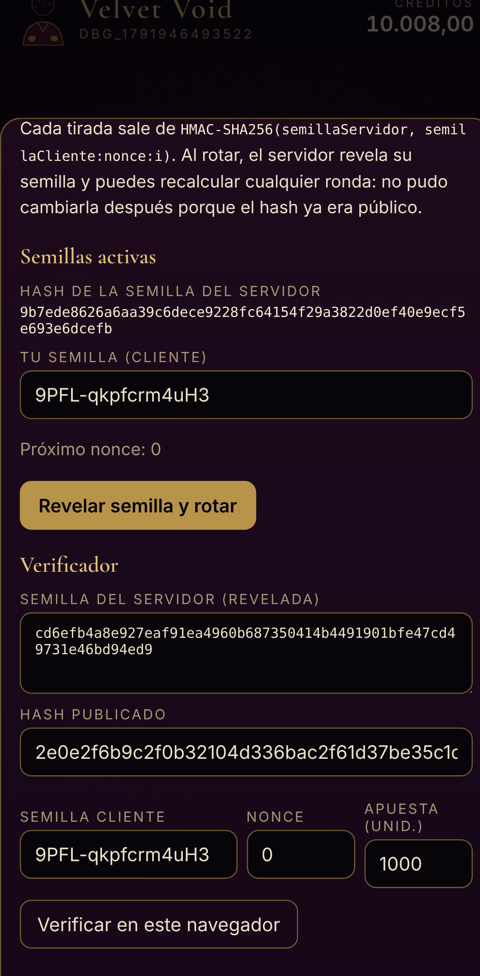

# Velvet Void

> *El terciopelo cede. La luz se escapa.*

Slot machine web **educativo**, con créditos 100 % ficticios. Lujo decadente sobre un vacío cósmico, con una mecánica propia (**Grietas de luz**) y una arquitectura en la que **el cliente nunca decide nada**: el servidor calcula cada resultado con un RNG criptográfico verificable (*provably fair*) y el canvas solo anima.

Sirve como portafolio y como material para aprender cómo funciona un casino por dentro y cómo se blinda.

<p align="center">
  
</p>
<p align="center">
  
  
</p>

- **[DESIGN.md](DESIGN.md)**: mecánica, dirección artística, arquitectura, modelo de datos y matemática.
- **[SECURITY.md](SECURITY.md)**: cada defensa, la amenaza que cubre y los resultados de los ataques contra el propio juego.

> ⚠️ Sin dinero real, sin pagos y sin apuestas reales. Los créditos no se compran ni se canjean.

## La mecánica: Grietas de luz
5×3, 10 líneas. En los rodillos 2–4 puede caer una **Grieta**:
- Si cae en la **fila central**, se abre y lanza de 1 a 3 haces de luz (horizontal, vertical o diagonal) que convierten en wild todo lo que tocan.
- Arriba o abajo queda **sellada**.

| Métrica (calculada de forma **exacta**, recorriendo las 194 millones de combinaciones de paradas) | |
|---|---|
| RTP | **96,111 %** |
| Frecuencia de acierto | 35,8 % |
| Rondas con Grieta | 4,9 % (aportan el 38 % del RTP) |
| Volatilidad | 2,48× apuesta (media) |
| Premio máximo | 192× |

Un simulador Monte Carlo de 10 M de rondas, que pasa por el mismo camino HMAC que producción, cae a z = 0,27 del valor exacto.

## Stack
Monorepo **pnpm** con TypeScript estricto (`noUncheckedIndexedAccess`, `exactOptionalPropertyTypes`…).

| Paquete | Contenido |
|---|---|
| `packages/game-math` | Motor puro y determinista: RNG desde semillas, tiras, evaluación, RTP exacto y simulador. Lo usan el servidor, el verificador del navegador y los tests. |
| `packages/shared` | Esquemas Zod estrictos y tipos de la API. |
| `packages/server` | Fastify 5, Drizzle + Postgres 16, argon2id, ledger de doble entrada y rate limiting en memoria. |
| `packages/client` | Vite + React 19 (HUD), PixiJS 8 + GSAP (rodillos) y Howler (audio sintetizado en el navegador). |
| `attacks/` | Ataques contra el propio juego: cliente manipulado (Node) y repetición y carrera (k6). |
| `e2e/` | Playwright en móvil y escritorio contra el build de producción con CSP. |

## Puesta en marcha

Requisitos: Node 22, pnpm 10 (`corepack enable`) y Docker (o un Postgres 16 local).

```bash
pnpm install
cp .env.example .env
# rellena SEED_ENCRYPTION_KEY:
openssl rand -hex 32

pnpm db:up          # Postgres en Docker; crea los roles velvet_owner / velvet_app (db/init)
pnpm db:migrate     # tablas, triggers de inmutabilidad y permisos
pnpm dev            # servidor :3000 + cliente :5173 (Vite reenvía /api)
```

Abre <http://localhost:5173>. Crea una cuenta y empiezas con 10.000 créditos ficticios.

> **Sin Docker:** ejecuta `db/init/01-roles.sql` como superusuario en tu Postgres después de crear la base `velvet_void`.

## Tests

| Comando | Qué prueba |
|---|---|
| `pnpm -r test` | game-math (31 tests: RNG, sesgo, Grietas, vectores dorados, RTP) y servidor (42 tests contra Postgres real: auth, idempotencia, concurrencia, ataques directos a la BD) |
| `pnpm rtp:exact` | RTP teórico exacto (~45 s con 4 hilos). Con `--write` actualiza `math-report.json`. |
| `pnpm rtp:sim 10000000` | Simulación Monte Carlo comparada con el valor exacto (z-test) |
| `pnpm e2e` | Playwright: registro, tiradas, turbo/teclado, provably fair y reglas (móvil y escritorio) |
| `pnpm attack:tamper` | 21 ataques de cliente manipulado (necesita el servidor en marcha) |
| `pnpm attack:replay` / `pnpm attack:race` | k6: repetición del mismo `betId` y doble gasto concurrente |
| `pnpm audit` | Dependencias (0 vulnerabilidades) |

El servidor de tests usa la base `velvet_void_test`, que se recrea en cada ejecución.

## Despliegue

**Servidor (Fly.io)**
```bash
fly launch --no-deploy --copy-config        # usa fly.toml + Dockerfile.server
fly postgres create                         # crea los roles de db/init/01-roles.sql con contraseñas reales
fly secrets set DATABASE_URL=postgres://velvet_app:...  \
                MIGRATION_DATABASE_URL=postgres://velvet_owner:... \
                SEED_ENCRYPTION_KEY=$(openssl rand -hex 32)
fly deploy                                  # release_command aplica las migraciones antes de arrancar
```
Mantén **una sola máquina** mientras el rate limit esté en memoria (ver SECURITY.md §5). En Railway sirve el mismo `Dockerfile.server`.

**Cliente (CDN estático: Cloudflare Pages, Netlify…)**
```bash
VITE_API_BASE=https://api.tudominio.com pnpm --filter @velvet/client build   # → packages/client/dist
```
`public/_headers` aplica CSP, HSTS y demás cabeceras. Ajusta su `connect-src` al origen de la API. Sirve cliente y API **en el mismo sitio registrable** (`play.` y `api.` de un mismo dominio) para que la cookie `SameSite=Strict` funcione. Fija `CLIENT_ORIGIN` en el servidor al origen exacto del cliente.

## Decisiones que vale la pena leer en el código
- `packages/game-math/src/rng.ts`: HMAC como PRF y muestreo por rechazo.
- `packages/game-math/src/exact.ts`: RTP exacto con pesos enteros (sin errores de coma flotante).
- `packages/server/drizzle/0001_guards.sql`: append-only, cadena de saldos, doble entrada y compromiso de semillas, todo comprobado por Postgres.
- `packages/server/src/services/game.ts`: la apuesta completa en una transacción con lock e idempotencia.
- `packages/client/src/game/SlotStage.ts`: animación que siempre termina en el resultado del servidor.

## Licencia
MIT. Todo el arte está en el repositorio: los símbolos se dibujan por código, Vesper es un SVG vectorial dibujado a mano y el sonido se sintetiza en el navegador.
